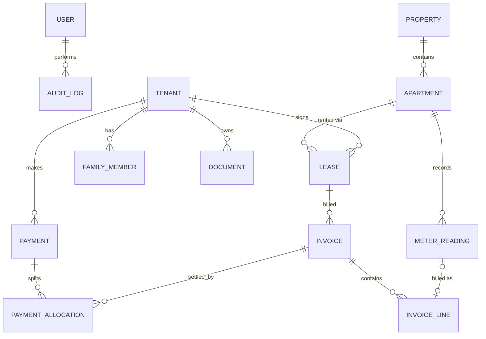

# STMS — Software Requirements Specification

**Product:** Shantikunjo Tenant Management System (STMS)
**Version:** 1.0 (draft)
**Date:** 2026-11-03
**Owner:** Abid Mahmood Akash

---

## 1. Overview

### 1.1 Purpose
STMS helps a landlord manage residential tenants, apartments, leases, rent collection and utility bills from one place, on desktop or phone. It replaces paper registers and spreadsheets with one record that shows **who lives where, what they owe and what has been collected**.

### 1.2 Scope
- **In scope (v1):** a web application for the landlord (admin). It covers tenant records with documents, apartment inventory, leases, monthly billing (rent, service charge and electricity), payment recording, dues tracking, an income dashboard and reports.
- **Phase 2:** tenant portal, notifications (SMS/email), maintenance requests, expenses and profit, deposit settlement.
- **Future:** multiple staff roles, online payment collection, Bangla UI, native mobile app.

### 1.3 Users and roles

| Role | Description | Phase |
|---|---|---|
| **Admin (Landlord)** | Full access to all data and settings. Primary user. | v1 |
| **Tenant** | Read-only access to their own lease, invoices and receipts. Can submit meter readings and maintenance requests. | Phase 2 |
| **Manager / Caretaker** | Delegated access: record payments and meter readings, no settings or deletions. | Future |

### 1.4 Operating context
- Country: Bangladesh. Currency: **BDT (৳)**. Timezone: **Asia/Dhaka**.
- Identity: National ID (NID). Police verification forms are required by the local police station (DMP Tenant Information Form or equivalent).
- Electricity is metered per apartment on **submeters**. The landlord pays the main utility bill and recovers the cost from each tenant.

### 1.5 Glossary

| Term | Meaning |
|---|---|
| Apartment / Unit | A rentable flat in a property. |
| Property / Building | A building containing apartments. v1 has one, but the model supports many. |
| Lease | The agreement between a tenant and an apartment for a period, with its financial terms. |
| Primary tenant | The person who signs the lease and is responsible for payment. |
| Family member | A person who lives with the primary tenant. |
| Service charge | A fixed monthly charge for common services (security, cleaning, lift, generator). |
| Security deposit | An advance held by the landlord, refundable at move-out minus deductions. |
| Notice period | The number of months' notice either party must give before ending the lease. |
| Invoice | The monthly bill for one lease and one billing period (YYYY-MM). |
| Due date | The **10th** of the billing month. |
| Arrears / Dues | Unpaid balance on invoices whose due date has passed. |

---

## 2. Functional requirements: core (from the brief)

Priority: **M** = must (v1), **S** = should (v1 if time allows), **P2** = phase 2, **F** = future.

### 2.1 Authentication and accounts (AUTH)

| ID | Requirement | Pri |
|---|---|---|
| AUTH-01 | Admin logs in with email and password. | M |
| AUTH-02 | Sessions use httpOnly, secure cookies (short-lived access token plus refresh token). The session survives a browser restart until logout or expiry. | M |
| AUTH-03 | Admin can log out. Logout revokes the refresh token. | M |
| AUTH-04 | Admin can change their password from Settings. | M |
| AUTH-05 | Forgotten password reset by emailed link. | S |
| AUTH-06 | Login is rate-limited: 5 failed attempts in 15 minutes locks login temporarily. | M |
| AUTH-07 | Tenant accounts are created from a tenant record (invite by phone or email) and see only their own data. | P2 |
| AUTH-08 | The initial admin account is created by a seed or CLI command, not by public sign-up. | M |

**Acceptance:** an unauthenticated request to any page except `/login` redirects to login. An unauthenticated API call returns 401.

### 2.2 Tenants (TEN)

| ID | Requirement | Pri |
|---|---|---|
| TEN-01 | Create a tenant with: full name\*, NID number\*, phone\*, email, permanent address\*, number of family members (derived from the list). | M |
| TEN-02 | Add, edit and remove family members. Each has a name\*, a relation to the primary tenant\* (spouse, son, daughter, father, mother, sibling, relative, other) and an optional phone. | M |
| TEN-03 | Upload a **passport-size photo** (JPG/PNG/WebP, ≤ 2 MB). It is shown as the tenant's avatar. | M |
| TEN-04 | Upload a **lease form** (PDF, ≤ 10 MB). | M |
| TEN-05 | Upload a **police verification form** (PDF, ≤ 10 MB). | M |
| TEN-06 | Files are stored in a private S3 bucket and opened through short-lived signed URLs. | M |
| TEN-07 | Search tenants by name, phone, NID or apartment number. Filter by status (active, former). | M |
| TEN-08 | Tenant detail page shows profile, family, documents, current lease, payment ledger and history of past leases. | M |
| TEN-09 | NID must be unique among tenants. Phone must be a valid BD number (`01XXXXXXXXX`). | M |
| TEN-10 | Tenants are **archived**, never hard-deleted, once they have any lease or invoice. | M |
| TEN-11 | Extra fields: occupation, employer/office, emergency contact (name and phone), previous address, date of birth. | S |
| TEN-12 | Flag on the record when the police verification form is missing. | S |

### 2.3 Apartments (APT)

| ID | Requirement | Pri |
|---|---|---|
| APT-01 | Create an apartment with: apartment number\* (e.g. "3B"), floor, number of rooms\*, toilets\*, balconies\*, facing\*. | M |
| APT-02 | Facing is one of: North, North-East, East, South-East, South, South-West, West, North-West. | M |
| APT-03 | Optional fields: size (sq ft), default rent, default service charge, meter number, notes. | S |
| APT-04 | Status is derived and shown: **Vacant**, **Occupied** (has an active lease) or **Maintenance** (set manually). | M |
| APT-05 | Apartment list with filters (status, floor, rooms) and a card grid on mobile. | M |
| APT-06 | Apartment detail shows the current tenant, lease terms, meter-reading history and income history. | M |
| APT-07 | Apartment number is unique within a property. | M |

### 2.4 Leases and assignment (LEA)

| ID | Requirement | Pri |
|---|---|---|
| LEA-01 | Assign a tenant to a **vacant** apartment by creating a lease with: start date\*, end date (optional, for open-ended leases), monthly rent\*, monthly service charge\*, security deposit\*, notice period in months\* (default 2), initial meter reading. | M |
| LEA-02 | An apartment can have only one active lease at a time. A tenant can have only one active lease at a time. | M |
| LEA-03 | Lease statuses: **Active**, **Notice given** (with move-out date), **Ended**. | M |
| LEA-04 | Record a notice: date given, by whom (tenant or landlord), and planned move-out date (default notice date plus the notice period). | M |
| LEA-05 | End a lease: final meter reading, actual move-out date. The apartment becomes vacant. | M |
| LEA-06 | Rent revision: change rent or service charge from an effective month. History is kept. | S |
| LEA-07 | Lease renewal: extend the end date and log the renewal. | S |
| LEA-08 | Record whether the security deposit was received (date, amount, method). | M |
| LEA-09 | Deposit settlement at move-out: deductions (unpaid dues, damages) and the refund amount. | P2 |

### 2.5 Electricity billing (ELEC)

| ID | Requirement | Pri |
|---|---|---|
| ELEC-01 | Record a monthly **submeter reading** per apartment: reading date, previous reading (auto-filled), current reading → units consumed. | M |
| ELEC-02 | The electricity **bill amount is entered manually** by the admin for now. | M |
| ELEC-03 | The current reading must be ≥ the previous reading, unless a meter reset is marked. | M |
| ELEC-04 | The electricity charge is added to that month's invoice as its own line, showing units and amount. | M |
| ELEC-05 | **Slab calculator**: a configurable slab table (units range → rate per unit, plus demand charge and VAT %). It suggests an amount that the admin can override. | S |
| ELEC-05a | **Low-usage flat rate** (configurable, on by default): if a month's units are at or below the limit (default 200), the bill is units × flat rate (default ৳8.50) with **no demand charge or VAT**. Above the limit, the full slab calculation applies. | S |
| ELEC-06 | Bulk entry screen: all occupied apartments in one list for fast monthly entry on a phone. | S |
| ELEC-07 | Tenants submit their own reading with a meter photo, and the admin approves it. | P2 |

### 2.6 Rent cycle, invoices and payments (BILL)

| ID | Requirement | Pri |
|---|---|---|
| BILL-01 | On the 1st of each month the system generates one invoice per active lease for that period, with lines for **Rent** and **Service charge**. Generation is idempotent: running it twice creates no duplicates. | M |
| BILL-02 | The admin can also generate invoices manually for any month. | M |
| BILL-03 | The invoice **due date is the 10th** of the billing month (configurable in Settings). | M |
| BILL-04 | The electricity line is added when a reading or amount is entered for that period. Other ad-hoc lines are allowed (water, gas, parking, repairs, discounts). | M |
| BILL-05 | Partial-month proration for the first and last months of a lease (by days). | S |
| BILL-06 | Invoice status: **Unpaid**, **Partially paid**, **Paid**, **Overdue** (unpaid or partial after the due date), **Void**. | M |
| BILL-07 | Record a payment: date, amount, method (Cash, Bank transfer, bKash, Nagad, Rocket, Cheque, Other), reference/TrxID, note. One payment can be allocated across several invoices, oldest first. | M |
| BILL-08 | Overpayment is held as tenant **credit** and applied to the next invoice automatically. | S |
| BILL-09 | Printable invoice and money receipt (A4 and mobile-friendly; PDF download). Sequential numbers (`INV-2026-0001`, `RCT-2026-0001`). The printed invoice is a one-page branded A4 layout: tenant and invoice details, charges, totals with balance due, payments received, a note, accepted payment methods, and office contact details. | S |
| BILL-10 | Late fee rule: a flat or percentage fee after N days past due. Off by default. | P2 |
| BILL-11 | Every financial change is recorded in an audit log. Paid invoices cannot be edited, only voided with a reason. | M |

### 2.7 Income tracking and dues (REP)

| ID | Requirement | Pri |
|---|---|---|
| REP-01 | **Monthly income report**: collected vs. expected for a selected month, broken down by type (rent, service charge, electricity, other) and by apartment. | M |
| REP-02 | **Dues report**: every tenant with an outstanding balance, the oldest unpaid month, and amounts split by type. | M |
| REP-03 | **Tenant ledger**: a chronological list of invoices and payments with a running balance. | M |
| REP-04 | Arrears aging buckets: current, 1–30, 31–60, 61–90, 90+ days. | S |
| REP-05 | Yearly summary: 12 months of collected vs. expected. | S |
| REP-06 | Occupancy report: occupied vs. vacant over time, and vacancy loss. | S |
| REP-07 | Export any report to CSV and PDF. | S |

### 2.8 Dashboard (DASH)

| ID | Requirement | Pri |
|---|---|---|
| DASH-01 | KPI tiles: **Collected this month**, **Expected this month**, **Outstanding dues (total)**, **Occupancy** (occupied / total), **Overdue tenants count**. | M |
| DASH-02 | Chart: 12-month **income trend** (collected vs. expected). | M |
| DASH-03 | Chart: this month's collection **by type** (rent, service charge, electricity, other). | M |
| DASH-04 | List: **who still owes**, sorted by amount and age, with a one-tap "Record payment". | M |
| DASH-05 | List: upcoming events: leases ending or under notice in the next 60 days, and the due date countdown. | S |
| DASH-06 | Quick actions: Add tenant, Record payment, Enter meter readings, Generate invoices. | M |

---

## 3. Functional requirements: standard features of comparable systems

These features are common in rental/property management products (e.g. tenant ledgers, rent rolls, expense tracking, tenant portals). They are included so v1's data model does not block them later.

### 3.1 Property management (PROP)
| ID | Requirement | Pri |
|---|---|---|
| PROP-01 | Property record: name, address, photo, total floors. v1 ships with one property, and the UI hides the property switcher until a second one exists. | M (model) / F (UI) |
| PROP-02 | Common facilities and parking slots assigned to apartments. | F |

### 3.2 Expenses and profit (EXP)
| ID | Requirement | Pri |
|---|---|---|
| EXP-01 | Record building expenses: date, category (maintenance, repairs, common electricity, water, gas, staff salary, security, cleaning, tax/holding tax, other), amount, note, receipt upload. | P2 |
| EXP-02 | Net income report (income − expenses) per month and year. | P2 |
| EXP-03 | Recurring expenses (e.g. guard salary). | F |

### 3.3 Maintenance requests (MNT)
| ID | Requirement | Pri |
|---|---|---|
| MNT-01 | Create a ticket per apartment: title, description, photos, priority, status (Open, In progress, Resolved). | P2 |
| MNT-02 | Tenants raise tickets from the portal. The admin sees and updates them. | P2 |
| MNT-03 | Cost of a repair can be logged as an expense or charged to the tenant's invoice. | P2 |

### 3.4 Notifications (NOT)
| ID | Requirement | Pri |
|---|---|---|
| NOT-01 | In-app notification centre (bell icon): overdue invoices, leases ending, missing documents. | S |
| NOT-02 | SMS reminders through a BD SMS gateway: invoice issued, 2 days before the due date, overdue. Templates are editable. | P2 |
| NOT-03 | Email copies of invoices and receipts. | P2 |

### 3.5 Tenant portal (PORT)
| ID | Requirement | Pri |
|---|---|---|
| PORT-01 | Tenant login (phone + OTP or password). | P2 |
| PORT-02 | View current dues, invoices and receipts. Download PDFs. | P2 |
| PORT-03 | Submit a meter reading with a photo. | P2 |
| PORT-04 | Raise maintenance requests. | P2 |
| PORT-05 | Pay online (bKash/SSLCommerz). | F |

### 3.6 Documents (DOC)
| ID | Requirement | Pri |
|---|---|---|
| DOC-01 | Document vault per tenant, with types: Photo, Lease form, Police verification, NID copy (front/back), Other. | M |
| DOC-02 | Preview in the browser and download. Replace an existing document, keeping old versions. | M / S |
| DOC-03 | Generate a pre-filled lease agreement PDF from lease data. | F |

### 3.7 Administration (ADM)
| ID | Requirement | Pri |
|---|---|---|
| ADM-01 | Settings: property details, rent due day (default 10), invoice prefix, default notice period, electricity flat rate and slab table, printed-invoice details (office phone and email, note, accepted payment methods), late fee rule, currency display. | M |
| ADM-02 | Audit log: who changed what and when, for financial records and tenant data. | M |
| ADM-03 | Database backups (daily, through the hosting platform) and a CSV export of all data. | S |
| ADM-04 | Additional staff users with roles. | F |
| ADM-05 | Bangla language UI and Bangla numerals. | F |
| ADM-06 | Dark mode. | S |

---

## 4. Non-functional requirements

| ID | Category | Requirement |
|---|---|---|
| NFR-01 | **Mobile-first** | Every screen is fully usable from 360 px wide. Touch targets ≥ 44 px. Bottom navigation on mobile, sidebar on desktop. Tables become card lists on small screens. |
| NFR-02 | Performance | First load (SSR) under 2.5 s LCP on 4G. Lighthouse Performance and Accessibility ≥ 90. API p95 < 300 ms for list endpoints with 1,000 tenants. Navigation responds at once with a skeleton screen, and main navigation pages are prefetched in the background. |
| NFR-03 | Security | Passwords hashed with argon2. httpOnly, Secure, SameSite=Lax cookies. Helmet security headers. Zod validation on every input. Rate limiting on auth. Parameterized queries (Prisma). |
| NFR-04 | Privacy | NID and documents are personal data. The S3 bucket is private and accessed only through signed URLs (≤ 10 min expiry). NID is masked in lists (`••••••1234`). |
| NFR-05 | Data integrity | Money is stored as `DECIMAL(12,2)`, never as floats. Financial writes run in database transactions. Invoices are idempotent per (lease, period). |
| NFR-06 | Time | All dates are calculated in Asia/Dhaka. Billing periods use `YYYY-MM`. |
| NFR-07 | Accessibility | WCAG 2.1 AA: colour contrast, keyboard navigation, form labels, focus states. |
| NFR-08 | Usability | Core tasks take at most 3 taps from the dashboard: record payment, add tenant, enter reading. Forms save drafts and show clear inline errors. |
| NFR-09 | Deployability | Deployable on **Dokploy** as two images (API and web), each with its own Dockerfile, plus PostgreSQL. Only the web app is public; it reaches the API over the internal network. Configuration through environment variables only. |
| NFR-10 | Observability | Structured JSON logs. `/api/health` endpoint. Errors include a request ID. |
| NFR-11 | Branding | The UI follows the *STMS Brand Style Guide Board*: Plus Jakarta Sans font, Primary `#0B2D6B`, Accent `#2563EB`, Primary Light `#E8F0FF`, Text `#1F2937`, Muted `#6B7280`, Border `#E5E7EB`, and outline icons. |

---

## 5. Data model

| Entity | Key fields |
|---|---|
| **User** | id, name, email (unique), passwordHash, role (ADMIN, TENANT), tenantId?, isActive, lastLoginAt |
| **Property** | id, name, address, floors |
| **Apartment** | id, propertyId, number, floor, rooms, toilets, balconies, facing (enum), sizeSqft?, meterNo?, defaultRent?, defaultServiceCharge?, maintenance (bool), notes |
| **Tenant** | id, fullName, nid (unique), phone, email?, permanentAddress, occupation?, emergencyContactName?, emergencyContactPhone?, photoDocumentId?, archivedAt? |
| **FamilyMember** | id, tenantId, name, relation (enum), phone? |
| **Document** | id, tenantId, type (PHOTO, LEASE_FORM, POLICE_VERIFICATION, NID_COPY, OTHER), s3Key, fileName, mimeType, size, uploadedAt |
| **Lease** | id, tenantId, apartmentId, startDate, endDate?, rent, serviceCharge, securityDeposit, depositReceivedAt?, noticeMonths, status (ACTIVE, NOTICE, ENDED), noticeGivenAt?, moveOutDate?, endedAt? |
| **MeterReading** | id, apartmentId, leaseId?, period (YYYY-MM), readingDate, previous, current, units, amount, isReset |
| **Invoice** | id, number (unique), leaseId, tenantId, period, issueDate, dueDate, subtotal, paidAmount, status, voidReason? — unique (leaseId, period) |
| **InvoiceLine** | id, invoiceId, type (RENT, SERVICE_CHARGE, ELECTRICITY, WATER, GAS, OTHER, DISCOUNT), description, amount, meterReadingId? |
| **Payment** | id, number (unique), tenantId, date, amount, method (enum), reference?, note? |
| **PaymentAllocation** | id, paymentId, invoiceId, amount |
| **Setting** | key, value (JSON): dueDay, invoicePrefix, slabTable, lateFee… |
| **AuditLog** | id, userId, action, entity, entityId, diff (JSON), createdAt |

Derived values (never stored): apartment status, tenant balance (Σ invoice totals − Σ allocations), invoice overdue state (`status ∈ {UNPAID, PARTIAL} ∧ dueDate < today`).

---

## 6. Key user flows

1. **Move-in:** Apartments → pick a vacant apartment → *Assign tenant* → choose an existing tenant or create one inline → enter lease terms and the initial meter reading → record the deposit → done. The apartment shows Occupied.
2. **Monthly cycle:** On the 1st, invoices are generated automatically → admin opens *Billing → Meter readings* and enters each apartment's reading and amount → electricity lines are added → tenants pay by the 10th → admin taps *Record payment* → the dashboard updates.
3. **Chasing dues:** Dashboard *Who still owes* → tenant → ledger → record payment (or send a reminder in Phase 2).
4. **Move-out:** Tenant → lease → *Give notice* → on the move-out date, *End lease* with the final reading → the final invoice is generated → (Phase 2) deposit settlement.

---

## 7. Screens

| Screen | Route | Notes |
|---|---|---|
| Login | `/login` | Brand hero panel (desktop), compact logo (mobile). |
| Dashboard | `/dashboard` | KPIs, charts, dues list, quick actions. |
| Tenants list / new / detail / edit | `/tenants`, `/tenants/new`, `/tenants/[id]`, `/tenants/[id]/edit` | Detail page has tabs: Profile, Family, Documents, Lease, Ledger. |
| Apartments list / new / detail / edit | `/apartments`, … | Card grid with status badges. |
| Leases list / new / detail | `/leases`, `/leases/new`, `/leases/[id]` | Assign, notice, end. |
| Billing | `/billing` | Invoices by month, generate, filter by status. |
| Invoice detail | `/billing/invoices/[id]` | Lines, payments, print (one-page A4 layout). |
| Record payment | `/billing/payments/new` | Pre-filled from tenant/invoice. |
| Meter readings | `/billing/meter-readings` | Bulk monthly entry. |
| Reports | `/reports` | Monthly income, dues, ledger, aging. |
| Settings | `/settings` | Property, billing rules, slabs, account. |

Mobile navigation (bottom bar): **Home · Tenants · Apartments · Billing · More**.

---

## 8. Roadmap

| Phase | Contents |
|---|---|
| **v1.0 (MVP)** | AUTH-01..04, 06, 08 · TEN · APT · LEA-01..05, 08 · ELEC-01..04 · BILL-01..04, 06, 07, 11 · REP-01..03 · DASH-01..04, 06 · DOC-01 · ADM-01, 02 · Dokploy deployment |
| **v1.1** | All **S** items: slab calculator, bulk readings, receipts/PDF, credit balance, proration, aging, exports, in-app notifications, dark mode |
| **v2.0** | Tenant portal, SMS/email, maintenance, expenses and profit, deposit settlement, late fees |
| **Future** | Staff roles, online payments, Bangla UI, multiple properties UI, generated lease PDFs |

---

## 9. Assumptions and open questions

1. One building at launch. Is the building name/address "Shantikunjo Residency, 123 Shantikunjo Road" from the style guide real or a placeholder?
2. S3 bucket details will be provided by the owner (AWS S3 or an S3-compatible service).
3. Is the security deposit expressed as a fixed amount or as a number of months' rent? (Stored as an amount; the UI can offer "× months" as a helper.)
4. Which electricity slab table applies (DESCO / DPDC / BPDB residential)? A default can be pre-loaded and then edited. *Update:* low usage (≤ 200 units) is billed at a flat ৳8.50/unit with no demand charge or VAT (ELEC-05a). With the default rates, 200 units on the flat rate (৳1,700) costs more than 201 units on the slabs (৳1,411.29). Confirm that this is intended.
5. Is rent billed in advance (the month's rent due on the 10th of the same month)? This document assumes **yes**.
